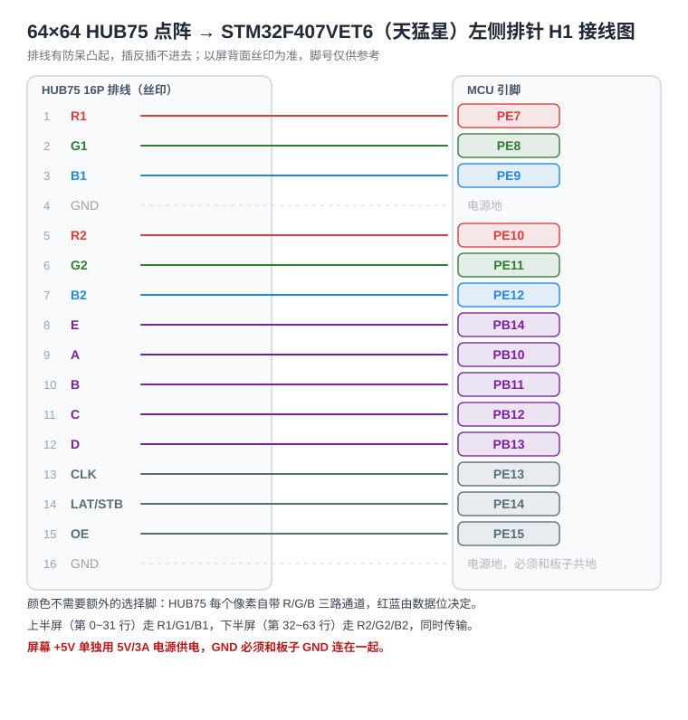

# 64×64 点阵屏显示铺满全屏的数字 "3"（上红下蓝）

STM32F103C8T6（蓝板 / 最小系统板，72MHz）驱动 RGB-Matrix-P2-64x64 全彩点阵，
开机自检后整屏显示一个数字 **3**：上半部分红色、下半部分蓝色，字形铺满 64×64。


> 上图是 `inc/glyph3_data.h` 里那份字模表还原出来的 64×64 实际像素，
> 和屏上点亮的是同一份数据。

---

## 0. 先纠正一个前提：这不是 OLED

你贴的接口表是 **HUB75**，不是 OLED 的 SPI/I2C：

| | 常见 0.96" OLED | 你这块 RGB-Matrix-P2-64x64 |
|---|---|---|
| 接口 | I2C / SPI，4~7 根线 | HUB75，14 根信号线 |
| 颜色 | 单色（白/蓝） | 每像素独立 R/G/B 三通道 |
| 含义 | 一个像素 = 1 位 | 一个像素 = 3 个亮度值 |

**所以"控制颜色的引脚"在 HUB75 上不存在，也不需要。**
红蓝不是靠一根引脚切换的，而是每个像素自带 R/G/B 三条电流通道：
面板上的 `R1/R2` 是红色数据线，`B1/B2` 是蓝色数据线，两路同时并行传输。
本工程里"决定颜色"的就是这 4 根线 —— 它们的 GPIO 编号由我在下面指定。

---

## 1. 硬件清单

| 器件 | 型号 | 备注 |
|---|---|---|
| 主控板 | STM32F103C8T6 最小系统板（蓝板） | 72MHz，64KB Flash / 20KB SRAM |
| 显示屏 | RGB-Matrix-P2-64x64（或 -B） | HUB75 接口，**1/32 扫描**，5V/3A |
| 排线 | 16P IDC 灰排线 | 屏通常自带 |
| 电源 | 5V / 3A 以上 | **必须单独供电** |
| 调试器 | ST-Link V2 | 或者用串口 ISP 下载 |

⚠️ **供电**：屏的 `+5V` 绝对不能从蓝板的 `5V` 引脚取。蓝板的 5V 是 USB 直通，
整块板子的走线和二极管都按 500mA 设计，屏一亮就是 2~3A，轻则重启重则烧线。
正确接法：外部 5V/3A 电源 → 屏的 `+5V`；电源负极 → 屏 `GND` **并且**接到蓝板的 `GND`。
**必须共地**，不共地数据线和行选全是乱的。

⚠️ 电平：F103 是 3.3V 逻辑，屏上的 74HC245 缓冲器吃 3.3V 输入没问题，不用电平转换。

---

## 2. 接线表（核心）



排线有防呆凸起，插反插不进去。**以面板丝印为准**，脚号仅供参考。
蓝板两侧各 20 针，丝印直接标 `A0`~`A15` / `B0`~`B15`。

### 2.1 屏幕 → 开发板

| 屏幕丝印 | 排线脚号 | 板子丝印 | MCU 引脚 | 作用 |
|---|---|---|---|---|
| `R1` | 1 | E07 | **PE7** | 上半屏红色数据 |
| `G1` | 2 | E08 | **PE8** | 上半屏绿色数据 |
| `B1` | 3 | E09 | **PE9** | **上半屏蓝色数据** |
| `R2` | 5 | E10 | **PE10** | 下半屏红色数据 |
| `G2` | 6 | E11 | **PE11** | 下半屏绿色数据 |
| `B2` | 7 | E12 | **PE12** | **下半屏蓝色数据** |
| `CLK` | 13 | E13 | **PE13** | 移位时钟，上升沿移入一位 |
| `LAT/STB` | 14 | E14 | **PE14** | 锁存，高脉冲把 64 列数据打进屏 |
| `OE` | 15 | E15 | **PE15** | 输出使能，**低电平点亮** |
| `A` | 9 | B10 | **PB10** | 行选 bit0 |
| `B` | 10 | B11 | **PB11** | 行选 bit1 |
| `C` | 11 | B12 | **PB12** | 行选 bit2 |
| `D` | 12 | B13 | **PB13** | 行选 bit3 |
| `E` | 8 | B14 | **PB14** | 行选 bit4（1/32 扫描必需） |
| `GND` | **4、16** | GND | 板子 GND（三方共地） | 只有这两个脚是地 |
| `+5V` | — | — | 走屏背面电源座 | **排线里没有电源线** |

> ⚠️ **两个常见误会，必须说清：**
>
> 1. **第 8 脚是 `E`，不是地。** 老式不带 E 的 HUB75 才是 4/8/16 三个地；
>    你这块 1/32 扫描的 64×64 屏第 8 脚被用作行选 `E`。把 E 接地会让地址只剩
>    0~15，直接导致只亮一部分行。
> 2. **16P 排线里没有 +5V。** 屏的电源走背面单独的 2 针 / 4 针座
>    （VH4 或 XH2.54），排线只传信号。往排线第 1 脚灌 5V 会打到 R1 上。

> 第 8 脚在很多老式 HUB75 上是 GND；你这块 1/32 扫描的 64×64 屏把它用作 `E`。

### 2.2 为什么选这 14 个脚

C8T6 是 LQFP48 封装，**一共只有 37 个 IO**（PA0~PA15 / PB0~PB15 / PC13~PC15），
比 F407 的 82 个少一半，所以每一个都得算着用。已经占掉或不能动的：

| 引脚 | 为什么不能用 |
|---|---|
| PC13 | 板载 LED（低电平点亮） |
| PA13 / PA14 | SWD 下载调试口，占了就没法烧程序 |
| PA11 / PA12 | USB D-/D+ |
| PA9 / PA10 | USART1，板上标着 TX/RX，留着当串口调试 / 串口 ISP 下载 |
| PA15 / PB3 / PB4 | **复位后默认是 JTAG 引脚**，F1 要用得先关 JTAG（AFIO->MAPR），本工程直接避开 |
| PB2 | BOOT1，板上挂了 10k 下拉，不碰 |

剩下的正好排成两组连号：

- **PA0 ~ PA8** = 6 根数据 + CLK + LAT + OE（9 个连号）
- **PB5 ~ PB9** = 行选 A~E（5 个连号）

连号有什么用：`BSRR` 一次 32 位写就能同时改这 9 个脚，而且数据位正好是 `PA0~PA5`，
不用移位拼装 —— 这是这块 72MHz 的 M3 还能跑到 100Hz 刷新的关键。
行选同理，写地址只要 `a << 5` 一条指令。

所有引脚定义集中在 **`inc/board_pins.h`**，改接线只改这一个文件。

---

## 3. 代码结构

```
新型装甲板/
├── inc/
│   ├── board_pins.h      ★ 接线唯一真源：谁的哪个脚接屏的哪个信号
│   ├── board.h            时钟/延时接口
│   ├── hub75.h            HUB75 驱动接口（亮度、翻转等可调宏）
│   ├── glyph3.h           字模接口
│   ├── glyph3_data.h      2KB 字模表（tools/gen_glyph.py 生成）
│   ├── app.h              应用层
│   └── stm32f103_regs.h   最小寄存器定义（不依赖 HAL/CMSIS）
├── src/
│   ├── main.c             ★ 主流程：自检 → 画字 → 死循环扫描
│   ├── board.c            PLL 72MHz + SysTick 微秒延时
│   ├── hub75.c            ★ 位平面、扫描时序、BCM 调光、BSRR 查表
│   ├── glyph3.c           查字模表
│   └── app.c              字模 + 颜色 → 写位平面
├── startup/               GCC 启动文件
├── MDK-ARM/               Keil 启动文件 + 分散加载文件
├── docs/wiring.svg        接线示意图
├── tools/                 PC 端工具（不参与固件编译）
├── .vscode/               VSCode 任务 / 调试 / CMake 配置
├── cmake/
│   └── gcc-arm-none-eabi.cmake   交叉编译工具链文件
├── CMakeLists.txt         ★ 构建入口
├── CMakePresets.json      ★ 预设（debug / release）
├── STM32F103C8T6.ld       GCC 链接脚本
└── README.md
```

整个工程**零第三方库**：不依赖 HAL、标准外设库、CMSIS。
寄存器地址全部手写在 `stm32f103_regs.h` 里，Keil 和 GCC 都能直接编译。

---

## 4. 编译与烧录

### 4.1 构建（CMake，已验证）

⚠️ **先看 4.5 节**：这个工程**必须放在纯英文路径下构建**，因为 CMake 处理不了中文路径。
当前文件夹 `E:/VScode/新型装甲板` 带中文，已经建好一个 ASCII 目录联接：

```
E:/VScode/m3   ->   E:/VScode/新型装甲板
```

**用 VSCode 打开 `E:/VScode/m3` 这个路径**，然后：

| 操作 | 效果 |
|---|---|
| `Ctrl+Shift+B` | 配置 + 编译 |
| 状态栏 CMake 的 Build 按钮 | 同上（走 CMakePresets） |
| `终端 → 运行任务 → flash (ST-Link)` | 编译 + 烧录 + 复位 |

命令行等价操作（Git Bash，在 `E:/VScode/m3` 下）：

```bash
cmake --preset debug                          # 配置，生成 build/
cmake --build --preset debug                  # 编译
cmake --build --preset debug --target flash   # 编译 + ST-Link 烧录
cmake --preset release            # -O2 版本（产物在 build-release/）
cmake --build --preset release
```

产物都在 `build/`：

```
build/matrix3.elf    调试用（cortex-debug 用这个）
build/matrix3.hex    ST-Link Utility / Keil 烧录用
build/matrix3.bin    0x08000000 烧录（串口 ISP 用这个）
build/matrix3.map    内存映射，排查段溢出用
```

编译结果（实测）：

```
Memory region         Used Size  Region Size  %age Used
           FLASH:        3780 B        64 KB      5.77%
             RAM:       11016 B        20 KB     53.79%
   text    data     bss     dec     hex
   3776       4   11012   14792    39c8    build/matrix3.elf
```

工具链不在 PATH 上？`CMakePresets.json` 里的 `environment.PATH` 已经指向
STM32CubeIDE 自带的 cmake / ninja / arm-none-eabi-gcc，不用另外装。

### 4.2 烧录到蓝板

蓝板**没有板载调试器**，两条路：

**① ST-Link（推荐）**
板上短边那排 4 针标着 `3.3 / DIO / CLK / GND`，对应 SWD 的
`3.3V / SWDIO / SWCLK / GND`，接 ST-Link V2 后直接烧 `build/matrix3.hex`。

> ⚠️ 这 4 根线**一根都不能少，也不能接反**。只接 3.3 和 GND 的话，
> ST-Link 会显示"电压 3.28V 正常"，但报 `Unable to get core ID` / `No STM32 target found`
> / `No device found on target` —— 因为 SWDIO/SWCLK 没通。山寨 ST-Link 小U盘的丝印
> 有时是反的，报这个错就先把 DIO 和 CLK 两根对调试试。

**先做这一步：确认 SWD 通了再谈其他。**

```
终端 → 运行任务 → check SWD (只连接不烧录)
```

- 打印出 `Device ID / Device name / NVM size` → 通了，可以去烧录了
- 报 `Unable to get core ID` / `No STM32 target found` → 按下面顺序查

**第 1 条几乎总是它：`stlinkserver.exe` 占着探针。**

ST 的工具链（CubeIDE / CubeProgrammer / ST-LINK GDB Server）会在后台拉起一个
`stlinkserver.exe`，它就是探针的独占锁。用过 Keil、或调试失败一次之后，这个进程可能残留，
之后 CubeProgrammer 就会一边报告 `Voltage 3.28V` 一边说 `Unable to get core ID` ——
**看起来像接线问题，其实是软件锁没释放**。

已实测：杀掉这个进程后同一个探针立刻读到芯片。

```
终端 → 运行任务 → release ST-Link
```

（`flash` 和 `F5` 两个任务已经自动带上了这一步，不用手动点。）

如果杀完还是不通，再按硬件排查：

| 顺序 | 检查项 | 怎么确认 |
|---|---|---|
| 2 | **DIO / CLK 接反** | 把这两根对调，重跑 check SWD |
| 3 | **4 根线是否都通** | 万用表蜂鸣档：ST-Link 的 DIO↔板子 DIO、CLK↔CLK、GND↔GND |
| 4 | **4 针排针焊没焊** | 蓝板很多批次出厂不焊排针，只是搭在焊盘上，量得到电压但过不了信号 |
| 5 | **复位键卡住 / 芯片关了 SWD** | 按住复位键点连接，看到 "Connecting" 再松手 |
| 6 | **杜邦线太长 / 板子没电** | 换短的；蓝板电源 LED 要亮 |

降频和复位下连接的写法（终端里直接跑）：

```
STM32_Programmer_CLI -c port=SWD freq=1000 mode=UR
```

**② 串口 ISP（SWD 修不好时的备用方案，完全绕开 ST-Link）**

F103 出厂固化在系统存储器里有一个串口 bootloader，只要 BOOT0 拉高就能从 USART1 灌程序，
**跟 SWD 一点关系都没有**。需要一根 USB-TTL（CH340 / CP2102 都行）。

1. `BOOT0` 跳线帽拨到 **1** 一侧，按一下复位
2. USB-TTL 接线：`TX → PA10(RX)`、`RX → PA9(TX)`、`GND → GND`（**TX/RX 要交叉**）
3. 设备管理器里看串口号，把 `.vscode/tasks.json` 里 `flash (串口 ISP)` 那条的
   `COM3` 改成你的（比如 `COM5`）
4. 跑任务 `flash (串口 ISP，绕过 SWD)`
5. 烧完把 BOOT0 **拨回 0**，再按一次复位 —— 程序才会正常运行

> 用 STM32CubeProgrammer 图形界面走这条路也一样：连接方式选 **UART**，端口选你的 COM 口，
> 波特率 115200，然后下载 `build/matrix3.bin` 到地址 `0x08000000`。

### 4.3 VSCode 里到底按哪个键

| 操作 | 干什么 | 说明 |
|---|---|---|
| `Ctrl+Shift+B` | **只编译** | 生成 build/matrix3.elf/hex/bin，不碰硬件 |
| `终端 → 运行任务 → flash` | 编译 + **烧录 + 复位运行** | 等价 `cmake --build --preset debug --target flash` |
| `F5` | 编译 + **进入调试** | 能打断点、看寄存器，走 SWD |

> **关于 F5 报错 `"makeDebugType" 设置为 "script" 的 "cmake" 调试类型要求定义 "cmake" 命令`**
>
> 这跟工程代码无关。当时工程是 **Makefile** 工程，没有 `CMakeLists.txt`；
> VSCode 里装了 CMake Tools 扩展，在**没有 launch.json** 的情况下会拿它自动生成的
> CMake 调试配置去调试，于是要求一个叫 `cmake` 的命令 —— 自然找不到。
> 现在工程已经改成 CMake 了，两边都对上了。
>
> 现在 `.vscode/launch.json` 已经写好了（cortex-debug + ST-LINK_gdbserver），
> F5 会走这个配置，不会再去找 cmake。
> 如果你之前手动选过 "CMake: Debug"，在调试下拉框里改选 **"调试 (ST-Link / SWD)"** 即可。
>
> **如果 F5 弹「配置的类型 cortex-debug 不受支持」**：说明 VSCode 没把 cortex-debug
> 扩展算进当前窗口。扩展是装着的（`marus25.cortex-debug 1.12.1`），按顺序试：
>
> 1. 点弹窗里的 **「安装 cortex-debug 扩展」**（让 VSCode 重新注册一遍，最省事）
> 2. 扩展面板搜 `cortex-debug` → 如果显示"已禁用"，点启用
> 3. `Ctrl+Shift+P` → **Developer: Reload Window**
> 4. 验证：`Ctrl+Shift+P` → **Developer: Show Running Extensions**，列表里要能看到 Cortex-Debug
>
> 调不出来也不影响跑程序 —— 用 `flash` 任务，整条链路不碰调试器。


### 4.4 Keil MDK（ARMCC）

没有现成的 `.uvprojx`（不同版本的器件包差异太大，给错了反而打不开），
按下面 5 步新建，1 分钟搞定：

1. `Project → New μVision Project`，器件选 **STM32F103C8**
2. 弹出的 Run-Time Environment 直接关掉
3. 新建两个 Group，把 `src/*.c` 和 `MDK-ARM/startup_stm32f103xb_keil.s` 加进去
4. `Options for Target → C/C++ → Include Paths` 添加 `inc`
5. `Options for Target → Target` 勾选 **Use MicroLIB**；
   `Linker` 取消 `Use Memory Layout from Target Dialog`，Scatter File 选 `MDK-ARM/matrix3.sct`

### 4.5 为什么必须用英文路径（重要）

**CMake 在 Windows 上处理不了含中文的路径。** 这不是配置问题，是 CMake 本身的缺陷：
路径里的中文会用 ANSI 代码页传给子进程，被转成乱码，然后 cmake 直接崩。实测现象：

```
CMAKE_TOOLCHAIN_FILE:FILEPATH="E:/VScode/鏂板瀷瑁呯敳鏉?cmake/gcc-arm-none-eabi.cmake"
                                 ^^^^^^^^^^^^^^^^^^ 中文被转成乱码
进程退出码 -1073740791 (0xC0000409，STATUS_STACK_BUFFER_OVERRUN)
```

同一个工程复制到 `C:\temp\m3test` 下配置编译一次通过，所以可以确定是路径问题，
不是工程本身的问题（生成器换成 Ninja 也一样，所以只能改路径）。

**两个解法，选一个：**

| 方案 | 操作 | 说明 |
|---|---|---|
| ① 目录联接（推荐，已建好） | 用 VSCode 打开 `E:\VScode\m3` | 内容就是这个文件夹，路径变纯英文，原文件夹名不用动 |
| ② 直接改名 | `新型装甲板` → `matrix3` 之类 | 最彻底，但有其他工程引用这个路径的话要一起改 |

目录联接已经建好了。重装系统后要重建，在**资源管理器或 PowerShell** 里执行：

```bat
mklink /J E:\VScode\m3 E:\VScode\新型装甲板
```

删掉它不影响原文件夹，只是删掉那个"快捷方式"：`rmdir E:\VScode\m3`。

> 用 Keil 的话没有这个限制，中文路径也能编译（Keil 走自己的编译器接口）。

---

## 5. 20KB SRAM 的账（为什么这一版和 F407 版写法不一样）

F103C8T6 只有 20KB SRAM，稍微奢侈一点就爆。所以做了两个关键取舍：

| 做法 | F407 版（192KB RAM + FPU） | F103 版（20KB RAM，无 FPU） |
|---|---|---|
| 颜色数据 | RGB444 帧缓冲 8KB **+** 位平面 8KB = 16KB | **不做帧缓冲**，直接画进位平面 8KB |
| 字形 | 运行时用浮点算贝塞尔距离场 | 预渲染成 2KB 字模表放 Flash |
| RAM 占用 | 16.5KB / 192KB | **8.7KB / 20KB** |

把字形放在 Flash 里不只是省 RAM：Cortex-M3 没有硬件浮点，`sqrtf` 和浮点乘要靠软件模拟，
4096 个像素 × 71 段线段跑下来要一两秒，开机就卡住了。改成查表后启动是 0 延时。

字模表怎么来的：`tools/gen_glyph.py` 在 PC 上用"贝塞尔笔画 + 距离场"算出每个像素的
0~15 亮度等级，直接写成 `inc/glyph3_data.h`（64 行 × 32 字节，每字节打包左右两个像素）。
想改字形就改脚本里的 `SEGS` 六行控制点，重新跑一遍，单片机代码一个字都不用动。

---

## 6. 屏幕是怎么被点亮的

### 6.1 1/32 扫描

64×64 = 4096 个像素，但屏内部只有 1/32 的行驱动。行选 A~E 选中一对行
（第 `a` 行和第 `a+32` 行），然后：

- `R1/G1/B1` 把数据送进**上半屏**那一行
- `R2/G2/B2` 同时把数据送进**下半屏**那一行

32 个地址轮一遍 = 64 行全刷完。任何时刻只有 2 行在亮，靠视觉暂留拼成整屏。

### 6.2 一行数据的时序

```
OE   ▔▔▔▔▔▔▔▔▔▔▔▔▔▔▔▔▔▔▔▔▔╲______________╱▔▔▔▔▔▔▔   (低电平 = 点亮)
CLK  _↕_↕_↕_↕_↕_↕_ ... 64 个上升沿 ... _↕_↕_↕_
LAT  __________________________╱▔▔╲________________
行选 <------------- 本行期间保持不变 ------------->
```

1. `OE=1` 关显示（移位过程中屏必须是黑的，否则数据会"爬"出鬼影）
2. 64 个 CLK，把 64 列 × 6 bit 数据移进屏的移位寄存器
3. `LAT` 一个高脉冲，数据锁存到输出
4. `OE=0` 点亮，亮 `2^b × 16µs`
5. `OE=1` 熄灭，换下一个位平面

> ⚠️ 注意方向：移位寄存器是**先入后出**，第一个移进去的位要走完 64 级才停下，
> 最后落在**最右边**。所以第 63 列必须先送、第 0 列最后送（`hub75_set_pixel()` 里已经换算好）。
> 少这一步，整屏会左右镜像，"3" 会变成 "Ɛ"。

### 6.3 16 级亮度：BCM

每个地址重复 4 次，第 b 次点亮 `2^b` 个基准时间：

| 位平面 | 点亮时间 | 权重 |
|---|---|---|
| b=0 | 16µs | 1 |
| b=1 | 32µs | 2 |
| b=2 | 64µs | 4 |
| b=3 | 128µs | 8 |

四段加起来 0~15 级灰度。全 1 的像素亮 240µs，中间值就是抗锯齿边缘的那种"半亮"。

实测一帧：`32 × (4×16µs 移位 + 240µs 点亮) ≈ 9.8ms` → **约 100Hz**，肉眼不闪。

### 6.4 一次 BSRR 写 9 个脚

`GPIOA->BSRR` 低 16 位置 1、高 16 位清 0，一次 32 位写就能同时设定
所有数据线 + CLK + LAT + OE。所以 `hub75_init()` 预先算了 64 个 BSRR 字
（每种 6bit 组合一个），扫描内层循环只剩两条写指令：

```c
HUB_GPIO->BSRR = s_lut_lo[v];   // 数据 + CLK=0 + OE=1（关显示）
HUB_GPIO->BSRR = s_lut_hi[v];   // 数据 + CLK=1  -> 上升沿，移入一位
```

`HUB_ALL_MASK` 保证只动 PA0~PA8，同端口的 PA9/PA10（串口）等不受影响。

---

## 7. 可调参数

全部在 `inc/hub75.h` 和 `src/main.c` 顶部：

| 宏 | 位置 | 默认 | 说明 |
|---|---|---|---|
| `HUB75_BCM_BASE_US` | hub75.h | 16 | 基准点亮时间。调大更亮、刷新率降低 |
| `HUB75_CLK_NOP` | hub75.h | 2 | CLK 边沿前后插的空指令。花屏/串色就加到 4~5 |
| `HUB75_FLIP_X` | hub75.h | 0 | 显示左右镜像时改成 1 |
| `HUB75_FLIP_Y` | hub75.h | 0 | 显示上下颠倒时改成 1 |
| `BOOT_SELFTEST` | main.c | 1 | 开机三色+边框自检，调试完可以改 0 |
| `SPLIT_Y` | main.c | 32 | 红蓝分界线所在行 |
| `TOP_R/G/B`、`BOT_R/G/B` | main.c | 红 / 蓝 | 上下半部分颜色（每通道 0~15） |

---

## 8. 排错对照表

| 现象 | 原因 | 处理 |
|---|---|---|
| 全黑，一点不亮 | OE 没接 / 5V 没供上 / 没共地 | 万用表量屏的 5V 和 GND；确认 PA8 接到 OE |
| 开机三色正常，出字后全黑 | 位平面没写进去 | 确认 `app_draw_digit3()` 在死循环之前调用 |
| 只有一半（上下某一半）亮 | R2/G2/B2 那组没接 | 补 PA3/PA4/PA5 |
| 缺红色 / 缺蓝色 | 对应的 R 或 B 数据线断了 | 红 = PA0/PA3，蓝 = PA2/PA5 |
| 满屏雪花噪点、串色 | CLK 太快或排线太长 | `HUB75_CLK_NOP` 改 4~5 |
| 图像整体斜切、像被"推"了一列 | LAT 或 CLK 接触不良 | 重新压排线 |
| 图像上下分成两半、内容重复 | 扫描方式不是 1/32 | 你的屏可能不是这块 |
| 图像镜像 / 倒置 | 屏装的朝向不同 | `HUB75_FLIP_X` / `HUB75_FLIP_Y` 改 1 |
| 亮度很暗 | OE 反相或基准时间太短 | 确认 OE 低有效；`HUB75_BCM_BASE_US` 调到 24 |
| 有一条亮线/暗线不动 | 某个行选脚没接 | 检查 PB5~PB9 五根 |
| F5 弹「配置的类型 cortex-debug 不受支持」 | 扩展没被 VSCode 算进当前窗口（装了但禁用/没重载） | 见 4.3 的四步；不影响 flash 任务 |
| F5 日志停在 `Launching GDB`，或弹 `ST-LINK GDB Server Quit Unexpectedly` | **ST-Link 连不上芯片**，gdbserver 自己退出了；调试器本身没问题 | 跑 `check SWD` 任务确认；修不好就走 `flash (串口 ISP)` 那条路 |
| 程序不跑、连 LED 都不闪 | 时钟没起来 | `board_init()` 里已带 HSE 失败自动退回 HSI 64MHz |
| 烧录报 `No STM32 target found` / `Unable to get core ID`，但电压显示 3.28V | **`stlinkserver.exe` 占着探针**（软件锁，不是接线） | 跑 `release ST-Link` 任务；`flash` 和 `F5` 已自动带上这一步 |
| 烧录提示读保护 | 芯片被锁 | STM32CubeProgrammer → `OB` 页解除 RDP，或 ST-Link 用 Connect under reset 再全片擦除 |

---

## 9. 关于"1/32 扫描"

Waveshare 官方的 RGB-Matrix-P2-64x64 规格明确写 `Driving: 1/32 scan`，
接口定义里带 `E` 行选 —— 和本工程一致。

如果换上别的 64×64 屏出现"只亮一半"或"两个半屏重复"，说明它是
**1/16 扫描 + 4 组数据**的结构，那种屏需要 12 根数据线，本工程不适用。
判断方法：数一数屏背面 16P 座里有没有 `E` 丝印。

---

## 10. 已验证 / 未验证

| 项目 | 状态 |
|---|---|
| CMake 配置 + 编译（cmake 3.30 + Ninja + arm-none-eabi-gcc 14.3） | ✅ 实测通过，0 warning |
| 实机烧录（ST-Link + STM32CubeProgrammer 2.23） | ✅ 实测通过，0.26s 写入，复位运行 |
| 芯片识别 | ✅ `Device ID 0x410`、`Cortex-M3`、`NVM 128KB`（这颗实际是 128KB 版本，链接脚本按 64K 写，够用且安全） |
| Flash / RAM 占用 | ✅ FLASH 3780 B / RAM 11016 B（20KB 的 54%） |
| 向量表、栈顶（0x20005000）、链接地址 | ✅ objdump 核对 |
| 扫描内层循环指令数 | ✅ 反汇编核对，约 18 周期/像素 → 4MHz 像素时钟 |
| 字模表与预览图一致 | ✅ 同一份 `glyph3_data.h` 还原出 preview.png |
| 中文路径下的 CMake | ❌ CMake 自身会崩；已在 CMakeLists 顶部加检查，会打印明确提示（见 4.5） |
| 实屏点亮 | ❌ 手上没实物，需你接线上电确认 |

第一次上电建议保留 `BOOT_SELFTEST = 1`：先看红/绿/蓝三段纯色和白色边框，
三段都对说明 14 根线全通，再看 "3" 就稳了。

---

## 11. 和上一版（F407）的差异

如果你之前看过 F407 那一版，改到 C8T6 主要动了这些：

| 项目 | F407VET6 | F103C8T6 |
|---|---|---|
| 内核 / 主频 | Cortex-M4F @168MHz | Cortex-M3 @72MHz |
| 编译参数 | `-mcpu=cortex-m4 -mfpu=fpv4-sp-d16 -mfloat-abi=hard` | `-mcpu=cortex-m3` |
| GPIO 配置 | MODER / OTYPER / OSPEEDR（2 位/脚） | **CRL / CRH（4 位/脚）** |
| 时钟树 | APB1 ÷4、APB2 ÷2（全 84MHz） | APB1 **÷2**（36MHz 上限）、APB2 ÷1 |
| 延时时基 | DWT 周期计数器 | **SysTick**（山寨片也稳） |
| 数据/时序脚 | PB0/PB1/PB8/PB9/PB11~PB15 | PA0~PA8（连号，更省指令） |
| 行选脚 | PD8~PD12 | PB5~PB9 |
| 字形 | 运行时浮点距离场 | 2KB Flash 字模表 |
| 刷新率 | ~170Hz | ~100Hz |
